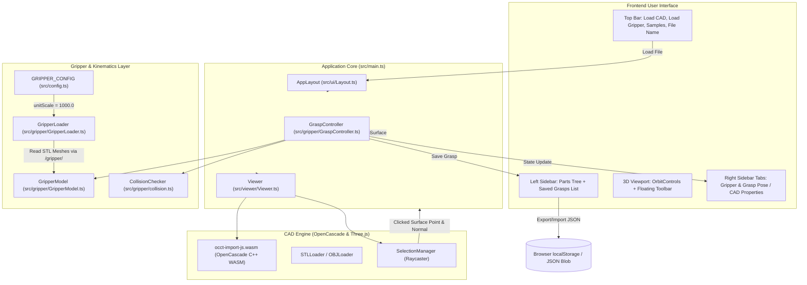

# CAD-Based Cobot Pick-Point Tool: Complete Architecture & Handoff Guide

> **Document Purpose**: This document provides a comprehensive technical overview and step-by-step handoff guide for what has been built in **Step 1** (CAD viewer & surface pick points) and **Step 2** (Robotiq 2F-85 gripper integration, TCP frame, manipulation, kinematics, collision checking, test sequence, and grasp persistence). It is written so that any software engineer, robotics engineer, or AI assistant can immediately understand the architecture, reproduce the setup, and extend the system for future tasks.

---

## 1. Executive Summary & System Objectives

The **CAD-Based Cobot Pick-Point Tool** is a high-performance, client-side web application designed to define and validate robotic cobot grasp poses directly on native CAD parts (similar to Pickit 3D and Photoneo CAD grasp planners).

### Core Capabilities
1. **CAD Ingestion**: Real-time browser-side parsing and triangulation of native STEP/STP files via OpenCascade WebAssembly (`occt-import-js`), plus binary STL and OBJ meshes.
2. **Robotics Coordinate System**: Strict **Z-up** convention matching industrial robotic workcells.
3. **Interactive Surface Pick-Point Extraction**: Raycasting calculates exact millimeter coordinates $(X, Y, Z)$ and surface normal unit vectors $\vec{N} = (Nx, Ny, Nz)$ on native solids.
4. **Gripper Integration (Robotiq 2F-85)**: Assembles the 2-finger adaptive gripper, unifies metric unit scales ($1.0\text{ m} \to 1000.0\text{ mm}$), and establishes the Tool Center Point (TCP).
5. **Interactive 6-DOF Manipulation & Snapping**:
   - `TransformControls` (Translate/Rotate, toggled via `T` / `R`).
   - Two-way numeric inputs ($X, Y, Z$ in mm, $Roll, Pitch, Yaw$ in degrees relative to the part origin).
   - Step jogging ($\pm X, \pm Y, \pm Z, \pm Rx, \pm Ry, \pm Rz$).
   - 1-click **"Snap to Clicked Point"** aligning TCP approach $+Z_{\text{approach}} = -\vec{N}_{\text{surface}}$.
   - **"Flip Approach (180°)"** and spin controls ($\pm 15^\circ, \pm 90^\circ$).
6. **Kinematic Finger Articulation**: 4-bar linkage open/close animation ($0\text{ to }85\text{ mm}$).
7. **Interference / Collision Detection**: Hierarchical bounding-box and mesh collision checking highlighting the gripper red on part contact.
8. **Automated Motion Test**: Animated 4-phase sequence (`Pre-grasp` $\to$ `Approach` $\to$ `Close` $\to$ `Lift` $\to$ `Restore`).
9. **Grasp Pose Persistence & JSON Export/Import**: Stores grasps locally and exports/imports downstream cobot-compliant JSON with standardized `Pose` schema (`position` + `orientation` quaternion).

---

## 2. Architecture & Data Flow



---

## 3. Detailed File Breakdown

```
nferent_cad/
├── index.html                     # Main HTML, loads occt-import-js.js script & mounts #app
├── package.json                   # Dependencies (three, @types/three, occt-import-js, vite)
├── tsconfig.json                  # TypeScript compiler options (ESNext, Node resolution)
├── vite.config.ts                 # Dev server configuration (local file streamer, fs allow)
├── public/
│   ├── occt-import-js.wasm        # 7.6MB OpenCascade WASM binary
│   ├── occt-import-js.js          # Glue script exposing window.occtimportjs
│   ├── gripper/                   # Symlink pointing to /home/human/nferent_cad/robotiq_2f85
│   └── samples/                   # Pre-bundled STEP and mesh sample files
│       ├── as1_pe_203.stp         # 18-solid assembly STEP model
│       ├── as1-oc-214.stp         # AP214 assembly STEP model
│       ├── dm1-oc-214.stp         # Machined part STEP model
│       ├── cube.stp, cube.stl, cube.obj
├── src/
│   ├── main.ts                    # Main orchestrator: wires viewer, layout, gripper, controller, storage
│   ├── config.ts                  # Centralized constants: GRIPPER_CONFIG, unitScale (1000.0), urdfFile
│   ├── types.ts                   # Core data interfaces: Pose, SavedGrasp, GripperState, PartInfo
│   ├── styles.css                 # Industrial light-theme design system (8px grid, status badges)
│   ├── gripper/
│   │   ├── GripperModel.ts        # Robotiq 2F-85 URDF scene graph, TCP frame, mimic joint kinematics
│   │   ├── GripperLoader.ts       # Loads URDF via urdf-loader, resolves package:// meshes, applies unit scale
│   │   ├── GraspController.ts     # TransformControls, snapping, flipping, jogging, animated test sequence
│   │   └── collision.ts           # Box3 and bounding-sphere CAD interference detection
│   ├── ui/
│   │   ├── Layout.ts              # App layout, top bar, floating viewport toolbar, tabs, toast, drag-drop
│   │   ├── GripperPanel.ts        # Right sidebar: numeric inputs, jogging grid, range slider, test buttons
│   │   ├── GraspList.ts           # Left sidebar: saved grasps tree, inline rename/delete, JSON export/import
│   │   ├── PartsList.ts           # Left sidebar: CAD solid hierarchy list, view camera presets
│   │   └── PropertiesPanel.ts     # Right sidebar: CAD metadata, bounding box, clicked surface point info
│   └── viewer/
│       ├── Viewer.ts              # Three.js canvas, Z-up camera, lighting, helpers, render loop
│       ├── loaders.ts             # occt-import-js WASM STEP parser, STLLoader, OBJLoader
│       └── selection.ts           # Pointer raycaster, face normal calculation, 3D pick-point marker
└── test/
    ├── test-step2-gripper.js      # Headless browser e2e acceptance test suite (13 checks)
    ├── test-skf-cam-roller.js     # SKF Cam Roller STEP test script
    └── e2e-browser-test.js        # Step 1 browser verification script
```

---

## 4. Key Engineering Decisions & Mathematics

### A. Coordinate Systems & Units
- **CAD Coordinate System**: Millimeters ($\text{mm}$), robotics **$Z$-up** convention ($\vec{Z} = [0, 0, 1]$ up, ground plane in $XY$).
- **Gripper Mesh Units**: The source assets in `/home/human/nferent_cad/robotiq_2f85` and `2f85.xml` are defined in **METERS**.
- **Centralized Conversion Rule**:
  ```typescript
  // src/config.ts
  export const GRIPPER_CONFIG = {
    folderPath: '/home/human/nferent_cad/robotiq_2f85',
    baseUrl: '/gripper/',
    unitScale: 1000.0, // 1.0 meter = 1000.0 mm
    defaultTcpOffset: 145.0, // mm
    defaultPreGraspDistance: 100.0, // mm
    minOpeningWidth: 0.0,
    maxOpeningWidth: 85.0
  };
  ```
  All vertex positions and body translation offsets are multiplied by `GRIPPER_CONFIG.unitScale` in [src/gripper/GripperLoader.ts](file:///home/human/nferent_cad/src/gripper/GripperLoader.ts#L51-L56). Nowhere else are units multiplied, ensuring zero unit divergence.

### B. Tool Center Point (TCP) & Frame Definitions
- The controllable root in Three.js (`gripperModel.root`) is located directly at the **TCP** (between fingertips).
- **Approach Vector**: $+Z_{\text{TCP}}$ points forward out of the fingertips in the direction of gripper approach.
- **Flange Body Offset**: The physical gripper mounting flange is positioned at $(0, 0, -\text{tcpOffset})$ inside `gripperModel.root`.
- **Part-Relative Grasp Transform ($T_{\text{part\_grasp}}$)**:
  Expressed as position $(X, Y, Z)$ in millimeters and orientation quaternion $(X, Y, Z, W)$ relative to the CAD part coordinate origin:
  ```typescript
  export interface Pose {
    position: { x: number; y: number; z: number };      // mm
    orientation: { x: number; y: number; z: number; w: number }; // unit quaternion
  }
  ```

### C. Surface Snapping Algorithm
When a user clicks on the CAD model, raycasting retrieves point $\vec{P}_{\text{surface}}$ and face normal $\vec{N}_{\text{surface}}$:
1. TCP position is set to $\vec{P}_{\text{surface}}$.
2. Approach vector $+Z_{\text{TCP}}$ is aligned with $-\vec{N}_{\text{surface}}$ (pointing into the solid):
   $$\vec{Z}_{\text{target}} = -\frac{\vec{N}_{\text{surface}}}{\|\vec{N}_{\text{surface}}\|}$$
   $$q_{\text{align}} = \text{QuaternionFromVectors}([0, 0, 1], \vec{Z}_{\text{target}})$$
3. **Flip Approach**: Rotates $180^\circ$ ($\pi$ rad) around local $X_{\text{TCP}}$, reversing the grasp direction.
4. **Spin Approach**: Rotates $\pm 15^\circ$ or $\pm 90^\circ$ around local $Z_{\text{TCP}}$ to align finger pads with the workpiece.

### D. Kinematic Finger Articulation (Official URDF 4-Bar Linkage)
The Robotiq 2F-85 gripper uses the official ROS `robotiq_description` URDF kinematic model loaded via `urdf-loader`.
All joints and links maintain complete structural integrity (no detached or floating links):
- **Base Link (`robotiq_85_base_link`)**: Rigid mounting frame at $(0, 0, 0)$.
- **Driving Joint (`robotiq_85_left_knuckle_joint`)**: Revolute joint on the base, rotating around axis $(0, -1, 0)$ with range $\theta \in [0.0, 0.8]\text{ rad}$:
  $$\theta = \left(1.0 - \frac{w}{85.0}\right) \times 0.8\text{ rad}$$
  where $w \in [0, 85]\text{ mm}$ is the opening width.
  - $w = 85.0\text{ mm}$ (fully open) $\implies \theta = 0.0\text{ rad}$.
  - $w = 0.0\text{ mm}$ (fully closed) $\implies \theta = 0.8\text{ rad}$.
- **Kinematically Coupled Mimic Joints**:
  - `robotiq_85_right_knuckle_joint`: Multiplier $-1.0 \implies -\theta$.
  - `robotiq_85_left_inner_knuckle_joint`: Multiplier $+1.0 \implies +\theta$.
  - `robotiq_85_right_inner_knuckle_joint`: Multiplier $-1.0 \implies -\theta$.
  - `robotiq_85_left_finger_tip_joint`: Multiplier $-1.0 \implies -\theta$ (keeps left finger pad parallel).
  - `robotiq_85_right_finger_tip_joint`: Multiplier $+1.0 \implies +\theta$ (keeps right finger pad parallel).
- **Zero Detachment**: All 8 moving linkage parts remain physically pinned to each other and to the base at their exact revolute joint origins.

### E. Animated "Test Grasp" Motion Sequence
The test motion verifies feasibility and clearance:
1. **Phase 1: Pre-Grasp** ($800\text{ ms}$): Fingers open to $85\text{ mm}$ while moving back along $-Z_{\text{approach}}$ by `preGraspDistance` ($100\text{ mm}$).
2. **Phase 2: Approach** ($1000\text{ ms}$): Linear interpolation along $+Z_{\text{approach}}$ into target grasp pose.
3. **Phase 3: Close** ($600\text{ ms}$): Fingers close to target opening width.
4. **Phase 4: Lift** ($900\text{ ms}$): Retracts back to pre-grasp standoff.
5. **Phase 5: Restore**: Restores user's editable pose and re-enables gizmos.

---

## 5. How to Run, Develop & Test

### Prerequisites
- Node.js $\ge 18$
- Linux / macOS / Windows with modern browser (Firefox / Chrome / Edge)
- Geckodriver (optional, for automated headless acceptance testing)

### Commands

| Task | Command | Description |
| :--- | :--- | :--- |
| **Install** | `npm install` | Installs project dependencies |
| **Dev Server** | `npm run dev` | Runs Vite dev server on `http://localhost:3000` |
| **Build** | `npm run build` | Compiles TypeScript (`tsc`) and builds production bundle (`vite build`) |
| **Preview** | `npm run preview` | Previews production build locally |
| **Run Acceptance Test** | `node test/test-step2-gripper.js` | Runs headless browser test suite verifying all 13 checks |

### Running the Acceptance Test
```bash
# 1. Start geckodriver on port 4444 (if not running)
geckodriver --port 4444 &

# 2. Run the test script
node test/test-step2-gripper.js
```
Expected output:
```
🚀 Starting Acceptance Test for STEP 2: CAD Cobot Pick-Point Tool...
1️⃣ Navigating to http://localhost:3000...
2️⃣ Waiting for CAD model and Robotiq 2F-85 Gripper to load...
   ✅ CAD model and Gripper loaded successfully!
3️⃣ Checking Gripper Panel values and state...
4️⃣ Testing Gripper Opening Width controls... (0mm, 42.5mm, 85mm)
5️⃣ Simulating surface point selection on the CAD model...
6️⃣ Testing "Snap to Clicked Point"...
7️⃣ Testing Step Jogging controls (+Z, +X)...
8️⃣ Testing "Flip Approach (180°)"...
9️⃣ Testing "Test Grasp" animated motion sequence...
🔟 Testing "Save Grasp Pose"...
1️⃣1️⃣ Saving a second grasp pose...
1️⃣2️⃣ Checking localStorage / Saved Grasps JSON structure...
1️⃣3️⃣ Capturing high-resolution verification screenshot...
🎉 ALL STEP 2 ACCEPTANCE TESTS PASSED SUCCESSFULLY! 🎉
```

---

## 6. Exported JSON Schema (Downstream Cobot Specification)

When clicking **"Export JSON"** or reading saved grasps, the format strictly adheres to:

```json
[
  {
    "id": "grasp_1793288098411_dccrf",
    "name": "Grasp Pose 1",
    "tcpPose": {
      "position": {
        "x": 17.500,
        "y": -8.399,
        "z": 12.690
      },
      "orientation": {
        "x": 0.7071,
        "y": 0.0000,
        "z": 0.7071,
        "w": 0.0000
      }
    },
    "rpy": {
      "roll": 180.0,
      "pitch": 90.0,
      "yaw": 0.0
    },
    "openingWidth": 85.0,
    "preGraspDistance": 100.0,
    "tcpOffset": 145.0,
    "createdAt": 1793288098411,
    "partName": "skf_cam_roller_305703_c-2z_0.stp"
  }
]
```

---

## 7. Guidelines for Future AI & Human Engineers

If you are continuing work on this codebase:

1. **Documentation Integrity**: Do not overwrite or remove existing comments and docstrings.
2. **Never Break Step 1**: Step 1 (CAD loading, OrbitControls, wireframe toggle, isometric views, part tree selection) must always remain functional.
3. **Unit Consistency**: Keep all millimeter conversions in `src/config.ts`. The 3D scene must always operate in **millimeters** and **Z-up**.
4. **TransformControls Safety**: In recent Three.js versions, `TransformControls` visibility must be manipulated via `transformControls.getHelper().visible`, not `transformControls.visible`.
5. **WASM Handling**: OpenCascade WASM requires `public/occt-import-js.js` and `public/occt-import-js.wasm`. Do not bundle `occt-import-js.wasm` via Vite inline assets; keep it as a static fetch from `public/`.
6. **Downstream Cobot Next Steps**:
   - **Step 3 (Reachability & Inverse Kinematics)**: Integrating a cobot arm model (e.g. Universal Robots UR5e/UR10e or Franka Emika Panda) to check kinematic reachability and joint limit compliance for defined pick poses.
   - **Step 4 (Bin / Obstacle Avoidance)**: Adding CAD collision bodies for bins, trays, or conveyor belts.
   - **Step 5 (Robot Communication)**: Generating URScript / RAPID / Python robot programs or exporting to ROS2 MoveIt.
